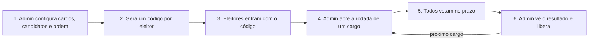
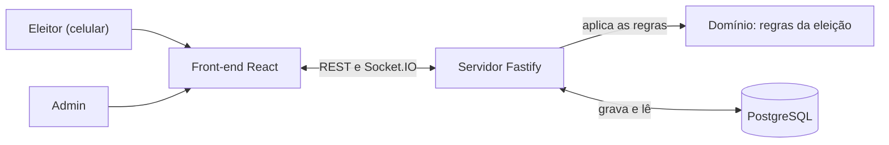
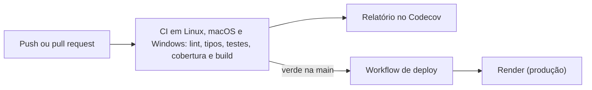
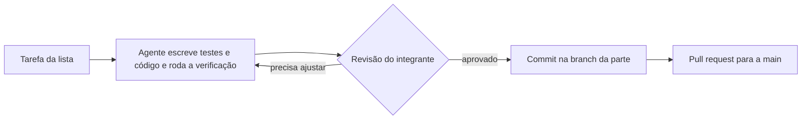
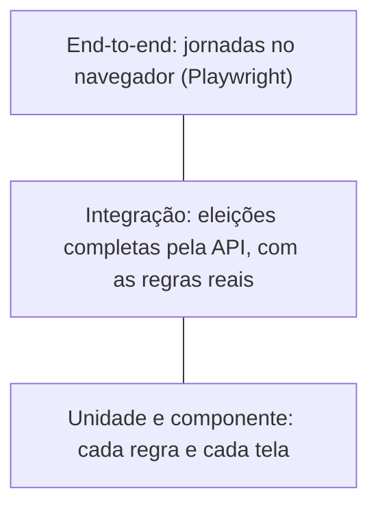

# Vota Aê

[](https://github.com/odannyraro/voto/actions/workflows/ci.yml)
[](https://codecov.io/gh/odannyraro/voto)

**Eleições ao vivo, no estilo Kahoot.** O admin conduz a votação cargo a cargo e os eleitores votam pelo celular, com o resultado aparecendo em tempo real. Trabalho prático da disciplina de Teste de Software (DCC/UFMG).

**Sistema no ar:** https://vota-ae.onrender.com

> O servidor está no plano gratuito do Render: depois de um tempo sem acesso, ele "dorme", e o primeiro acesso pode levar cerca de 1 minuto.

| Em números | |
|---|---|
| Testes automatizados | **1.190**, rodando a cada envio em Linux, macOS e Windows |
| Cobertura de linhas | de **90% a 100%** em cada pacote (mínimo exigido: 80%) |
| Teste de mutação | **91,9%** dos mutantes detectados nas regras da eleição |
| Deploy | automático, só depois de todos os testes passarem |

| Entrega | Link |
|---|---|
| Sistema em produção | https://vota-ae.onrender.com |
| Repositório | https://github.com/odannyraro/voto |
| Build no GitHub Actions | _a preencher: link da execução mais recente com sucesso_ |
| Relatório de cobertura (Codecov) | https://app.codecov.io/gh/odannyraro/voto |
| Vídeo no YouTube | _a preencher_ |

**Neste documento:** [Integrantes](#integrantes) · [Sobre o sistema](#sobre-o-sistema) · [Tecnologias](#tecnologias) · [Uso de IA](#uso-de-ia) · [Testes](#testes) · [Execução dos testes](#execução-dos-testes)

## Integrantes

| Integrante | Parte no projeto |
|---|---|
| Daniel Rodrigues | Front-end (telas do eleitor e do admin) e testes de ponta a ponta |
| Gustavo Chaves Ferreira | Servidor, banco de dados, CI/CD e deploy |
| Júlio Assis Souza Amorim | Regras da eleição (domínio) e teste de mutação |

## Sobre o sistema

O Vota Aê foi pensado para **eleições presenciais de grupos**, como a escolha de uma diretoria: todos estão na mesma sala, cada um com o seu celular, e a eleição acontece ao vivo, um cargo por vez.

### Como funciona



1. O **admin** entra com usuário e senha, cria a eleição e configura os cargos, os candidatos e a ordem de votação.
2. Ele gera os **códigos dos eleitores**: um código único e aleatório por pessoa, válido só naquela eleição.
3. O **eleitor** abre o site, digita o código e aguarda.
4. O admin abre a votação de um cargo, e a cédula aparece **na hora** no celular de todos, com um prazo para votar.
5. A rodada fecha quando todos votam ou quando o prazo acaba.
6. O admin vê o resultado e decide quando **liberá-lo** aos eleitores. Depois, segue para o próximo cargo.

### Regras da eleição

| Regra | Como funciona |
|---|---|
| **Candidatos** | Têm nome, idade e tempo restante na universidade, e podem concorrer a vários cargos, com um marcado como primeira opção |
| **Eleito sai da disputa** | Quem vence um cargo sai automaticamente dos cargos seguintes |
| **Segundo turno** | Com mais de 2 candidatos e ninguém acima de 50% dos votos válidos, o admin pode abrir um 2º turno com os dois mais votados |
| **Desempate** | Mais novo, mais velho ou mais tempo restante na universidade, escolhido em cada cargo |
| **Candidatos insuficientes** | O admin inclui um candidato de outro cargo, cadastra novos, move o cargo para o fim da fila ou, com dupla confirmação, o cancela |
| **Ordem de votação** | Definida pelo admin, com um botão que sugere uma ordem para evitar conflitos entre cargos |
| **Desfazer** | O admin volta passos da eleição (reabrir um cargo, desfazer a liberação de um resultado) e pode anular uma rodada |
| **Voto secreto** | O eleitor não vê os códigos dos outros nem a contagem antes da liberação; brancos não contam como votos válidos |

O texto original dos requisitos está em [docs/requisitos.md](docs/requisitos.md).

### Telas

| Quem | O que faz no site |
|---|---|
| **Eleitor** (`/`) | Entra com o código, acompanha a espera, vota (em um candidato ou em branco) com contagem regressiva e vê o resultado quando o admin o libera, tudo atualizado ao vivo |
| **Admin** (`/admin`) | Faz login, lista e cria eleições e as configura em abas: cargos e desempate, candidatos, códigos dos eleitores (gerar, copiar e revogar) e ordem de votação, com sugestão automática |
| **Admin, ao vivo** | Abre as rodadas, acompanha quantos já votaram, encerra antes do prazo, libera o resultado, anula uma rodada, desfaz a última ação e resolve 2º turno ou cargos sem candidatos suficientes |

_A preencher: botão para **abrir a eleição** na tela do admin (ainda não existe na interface) e, se o grupo quiser, capturas de tela._

## Tecnologias

| Área | Tecnologias |
|---|---|
| Linguagem | TypeScript em modo estrito e Node 24 |
| Front-end | React 19, React Router, cliente Socket.IO e build com Vite |
| Servidor | Fastify (API REST), Socket.IO (tempo real), Zod (validação), JWT (login) e bcrypt (senhas) |
| Banco de dados | PostgreSQL, hospedado no [Neon](https://neon.tech) |
| Testes | Vitest, Testing Library, MSW, pg-mem, StrykerJS e Playwright |
| Qualidade | ESLint, Prettier e cobertura mínima de 80% por pacote |
| CI/CD e nuvem | GitHub Actions, [Codecov](https://app.codecov.io/gh/odannyraro/voto) e [Render](https://render.com) |

### Arquitetura



O projeto é um **monorepo com quatro pacotes**, cada um com uma responsabilidade:

| Pacote | Responsabilidade |
|---|---|
| [`packages/domain`](packages/domain/src) | As **regras da eleição**, em funções puras: recebem a eleição e devolvem a eleição nova ou um erro de negócio. Sem banco, rede ou relógio próprio |
| [`packages/shared`](packages/shared/src) | Os **contratos** usados pelo servidor e pelo front: formatos de dados, códigos de erro, eventos e validação |
| [`apps/server`](apps/server/src) | O **servidor**: carrega a eleição, chama a regra, grava e avisa os celulares ao vivo |
| [`apps/web`](apps/web/src) | As **telas** do eleitor e do admin |

**Por que assim:** com as regras separadas do resto, elas são testadas de forma rápida e determinística, e tudo o que é externo (relógio, banco, rede) fica atrás de interfaces que os testes substituem. Detalhes em [docs/architecture.md](docs/architecture.md); rotas e eventos em [docs/api.md](docs/api.md).

### Integração e entrega contínuas



- [**CI**](.github/workflows/ci.yml): a cada envio, roda lint, formatação, checagem de tipos, todos os testes com cobertura e o build de produção, nos **três sistemas operacionais**.
- **Cobertura:** publicada no [Codecov](https://app.codecov.io/gh/odannyraro/voto), separada por pacote. Abaixo de 80% em qualquer um, o build falha.
- [**Deploy**](.github/workflows/deploy.yml): só quando o CI termina **verde na `main`**, publica exatamente aquele commit no Render. Código com teste quebrado não chega à produção.
- Todas as execuções ficam na aba [Actions](https://github.com/odannyraro/voto/actions).

## Uso de IA

O projeto foi desenvolvido com **agentes de IA para programação**: o **Claude Code**, usado por dois integrantes, e o **GitHub Copilot**, usado por um. Cada um usou a ferramenta que preferia, mas todos seguiram **as mesmas regras e o mesmo ciclo de trabalho**.

### 1. Regras comuns, escritas antes do código

Um arquivo Markdown, o [**CLAUDE.md**](CLAUDE.md), reúne as instruções que todo agente seguia a cada tarefa. Apesar do nome, ele é genérico e pode ser lido por qualquer ferramenta. Ele define:

- **TDD:** o teste vem primeiro e precisa falhar antes de o código existir;
- as **boas práticas de teste** da disciplina e a lista de *test smells* proibidos;
- o que o agente **não pode fazer**: apagar ou afrouxar testes para "ficar verde", reduzir a cobertura ou mexer na parte de outro integrante;
- o padrão das mensagens de commit.

### 2. Planejamento antes da execução

A [arquitetura](docs/architecture.md) e a [divisão do trabalho](docs/divisao-tarefas.md) foram escritas antes do código. Cada integrante teve uma **lista de tarefas pequenas** ([servidor](docs/todo-backend.md), [domínio](docs/todo-domain.md) e [front-end](docs/todo-frontend.md)), que também servia de **memória do agente**: ao concluir uma tarefa, ele registrava o que fez, as decisões e as pendências.

### 3. O ciclo de cada tarefa



Na revisão, o integrante testava o resultado e, quando precisava, **corrigia à mão ou pedia um novo ciclo** ao agente. A maior parte das tarefas foi feita numa branch específica de cada parte e levada à `main` por pull request.

### 4. O que as revisões encontraram

Ao fim de cada bloco de tarefas, o código foi revisado e refatorado. Essas revisões, junto com testes manuais no sistema real, acharam problemas que os testes ainda não cobriam. Cada um foi corrigido com um **teste de regressão escrito antes da correção**:

- votos enviados ao mesmo tempo eram recusados;
- requisições sem corpo podiam ser rejeitadas pelo servidor;
- uma configuração de produção aceitaria um segredo de desenvolvimento.

### 5. O que aprendemos

A IA acelerou muito a escrita de código e de testes, mas precisou de **regras claras, tarefas pequenas e revisão constante**. Sem isso, ela tende a escrever testes que nunca falham, mudar o comportamento ao "refatorar" ou declarar uma tarefa pronta sem conferir.

## Testes

### Estratégia



| Nível | O que verifica | Como | Exemplo |
|---|---|---|---|
| **Unidade** | Cada regra da eleição | Domínio real, sem simulações | [apuração e segundo turno](packages/domain/test/compute-result.test.ts) |
| **Componente** | As telas do front | Testing Library, rede simulada com MSW e socket falso | [painel ao vivo do admin](apps/web/test/admin-live-election.test.tsx) |
| **Integração** | Uma eleição completa pela API | Servidor com o domínio real, sem simular as regras | [fluxo de votação](apps/server/test/integration/election-flow.test.ts) e [segundo turno](apps/server/test/integration/runoff-flow.test.ts) |
| **Contrato** | Banco em memória e Postgres se comportam igual | A mesma suíte roda nos dois (com pg-mem) | [contrato do repositório](apps/server/test/contracts/election-repository.contract.ts) |
| **End-to-end** | Jornadas do usuário no navegador | Playwright | _a preencher_ |
| **Mutação** | Se os testes realmente detectam erros | StrykerJS no domínio | **91,9%** dos mutantes detectados |

### Boas práticas aplicadas

- **Teste antes do código** (TDD).
- **Limites das regras:** para "mais de 50%", há um teste com [um voto acima da metade e outro com exatamente a metade](packages/domain/test/compute-result.test.ts#L39-L61).
- **Concorrência:** [uma rajada de 100 votos simultâneos](apps/server/test/services/election-write-queue.test.ts#L69-L79) precisa ser toda aceita e contada.
- **Determinismo:** os testes de prazo não esperam o tempo passar: usam um [relógio falso](apps/server/test/doubles/fake-clock.ts), que o próprio teste adianta.
- ***Test doubles* só nas fronteiras** (relógio, agendador, rede, banco), a partir de interfaces do próprio projeto.
- **Padrão AAA**, um comportamento por teste e nomes que descrevem o cenário e o resultado esperado.

### Números e cobertura

| Pacote | O que é testado | Testes | Cobertura de linhas |
|---|---|---|---|
| `packages/domain` | Regras da eleição: apuração, segundo turno, desempates, exclusão do eleito, desfazer | 223 | 98% |
| `packages/shared` | Contratos e validação das requisições | 138 | 100% |
| `apps/server` | Rotas, tempo real, banco, prazos, concorrência e eleições completas pela API | 631 | 99% |
| `apps/web` | Telas do eleitor e do admin e comunicação com o servidor | 198 | 90% |
| e2e | _a preencher_ | _a preencher_ | — |

O relatório detalhado, arquivo por arquivo, está no [Codecov](https://app.codecov.io/gh/odannyraro/voto).

## Execução dos testes

**Pré-requisito:** Node.js 24.15 ou mais recente.

Na raiz do repositório:

```bash
npm ci                   # instala as dependências
npm test                 # roda todos os testes
npm run test:coverage    # roda os testes com cobertura (falha abaixo de 80% em algum pacote)
```

Os testes não precisam de banco de dados, internet nem configuração: usam banco em memória e relógio simulado. O relatório de cobertura de cada pacote fica em `<pacote>/coverage/index.html`.

Teste de mutação das regras da eleição (leva cerca de 2 minutos):

```bash
npm run test:mutation -w packages/domain
```

Testes end-to-end:

```bash
# a preencher
```

Para usar o sistema localmente (as eleições ficam em memória e somem ao fechar):

```bash
npm run build
ADMIN_USERNAME=admin ADMIN_PASSWORD=admin123 npm start   # abre em http://localhost:3000
```
